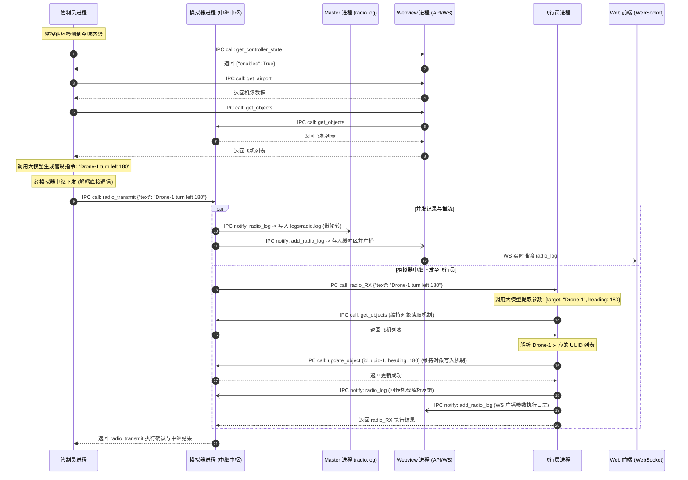
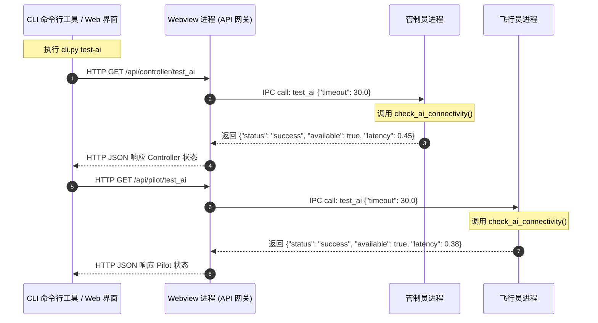
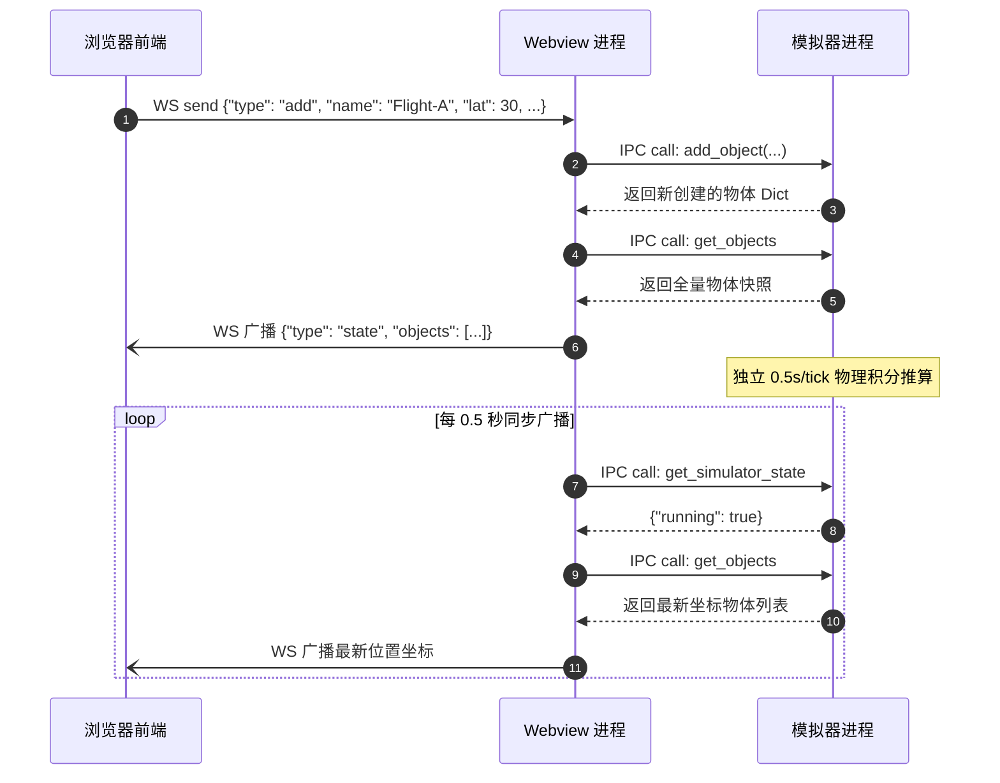

# 实时航空多智能体系统 - 架构与技术文档

本文档全面记录系统重构后的整体架构设计、进程职责、进程生命周期管理、管道进程间通信 (IPC) 协议及各进程开放的通信接口与消息传递流程。

---

## 1. 系统总体架构

本项目是一个基于数字孪生空域的实时航空多智能体协同系统。系统彻底摒弃了外部进程监管工具（如 Supervisord）及原 Platform 单进程内部多线程架构，重构为由 **Master 守护进程** 统一管理、基于 Python 原生 `multiprocessing` 库拉起并守护的 **4 大独立业务进程**，各进程之间全部通过 **双向管道 (`multiprocessing.Pipe`)** 进行高性能、低延迟的进程间通信。

### 1.1 进程拓扑与角色划分

系统由 1 个管理进程与 4 个核心业务进程组成：

```
+-------------------------------------------------------------------------------------------------+
|                                        Master 进程 (守护进程)                                    |
|   - 进程生命周期管理 (拉起 / 监控 / 重启 / 优雅关机)                                              |
|   - IPC 管道拓扑初始化与分发                                                                      |
+-------------------+--------------------+-----------------------+--------------------------------+
                    |                    |                       |
                    | (master_sim)       | (master_webview)      | (master_ctrl)
                    v                    v                       v
         +--------------------+  +--------------------+  +--------------------+
         |   飞行模拟器进程    |  |    Webview 进程    |  |    管制员智能体    |
         | (airplane_simulator|  |     (webview)      |  | (agent_controller) |
         +---------+----------+  +----+----------+----+  +---------+----------+
                   ^                  ^          ^                 |
                   | (pilot_sim)      |          | (webview_ctrl)  |
                   |                  |          +-----------------+
                   |                  | (webview_pilot)            |
                   |                  v                            | (ctrl_pilot)
         +---------+------------------+----+                       |
         |           飞行员智能体           |<---------------------+
         |           (agent_pilot)         |
         +---------------------------------+
```

### 1.2 进程功能与职责矩阵

| 进程名称 | 模块文件 | 核心职责 | 通信形式 |
| :--- | :--- | :--- | :--- |
| **Master 进程** | `src/master.py` | 全系统管理核心；负责 IPC 管道拓扑创建、各子进程启动、异常崩溃自动拉起、信号监听与优雅关闭；集中记录全系统日志 (`logs/master.log`) 并独立记录带有自动轮转的无线电通信专用日志 (`logs/radio.log`)。 | 管道 (`master_*`) 控制命令与日志 |
| **Webview 进程** | `src/platform/webview.py` | 系统的对外唯一接入网关；提供 HTTP REST 接口与 WebSocket 实时推送，接收 CLI 和 Web 前端请求；维护无线电日志内存缓冲区与分页端点 (`GET /api/radio_log`)；代理 Controller 与 Pilot 的测试请求。 | 对外：HTTP/WS (8000端口)<br>对内：IPC 管道 |
| **飞行模拟器进程** | `src/platform/airplane_simulator.py` | 独立物理推算引擎兼**无线电通信中继枢纽**；执行飞行器运动学解算；接收管制员无线电报文 (`radio_transmit`)，中继转发至飞行员 (`radio_RX`)，并同步推流至 Master (`radio_log`) 和 Webview (`add_radio_log`)。维持飞行员读写飞机的物理控制接口。 | 管道 (`webview_sim`, `pilot_sim`, `ctrl_sim`, `master_sim`) |
| **管制员智能体** | `src/agent_controller/controller.py` | 进近空管智能体；定时巡检空域态势，调用大模型分析潜在冲突与进近排序；**彻底解耦与飞行员的直接通信**，所有无线电管制指令统一经模拟器中继下发。 | 管道 (`ctrl_sim`, `webview_ctrl`) |
| **飞行员智能体** | `src/agent_pilot/pilot.py` | 机载飞行员智能体；通过模拟器中继管道接收管制员无线电指令 (`radio_RX`)；调用大模型解析自然语言语义；维持原有基于模拟器管道的飞机状态读写机制 (`get_objects`, `update_object`)。 | 管道 (`pilot_sim`, `webview_pilot`, `master_pilot`) |

---

## 2. 进程管理机制 (Process Management)

系统不再依赖 Supervisor，完全使用 Python `multiprocessing` 模块原生实现进程生命周期管理。

### 2.1 启动流程与守护进程化 (Daemonize)

用户通过 `python main.py start` (或 `src/main.py start`) 启动系统时，启动过程如下：

1. **初始启动进程** 创建 `MasterProcess` 实例。
2. 调用 `daemonize_master()` 执行经典的 **Unix 双重 Fork (Double-Fork)** 守护进程化流程：
   - 第一次 `os.fork()`：父进程打印启动成功提示与 Master PID，随后立即退出 (`sys.exit(0)`)，终端恢复就绪。
   - 子进程调用 `os.setsid()` 创建新会话，脱离原控制终端与进程组。
   - 第二次 `os.fork()`：防止该进程重新获取终端控制权。
   - 孙进程重定向标准输入至 `/dev/null`，标准输出/错误重定向至 `logs/master.log`。
   - 将 Master PID 写入 `logs/master.pid`。
3. **Master 进程** 初始化管道，依次通过 `multiprocessing.Process` 派生并启动 4 个子业务进程。
4. Master 进程进入健康巡检循环。

> **容器环境支持**：在 Docker 容器或调试环境下，可通过 `python main.py --foreground`（或 `-f` / `run`）直接在前台启动 Master 进程（PID 为 1），保持容器常驻运行并正确捕获容器编排信号。

### 2.2 故障检测与自动重启机制 (Auto-Restart)

Master 进程的主循环中以 1.0 秒为周期对所有子进程执行 `proc.is_alive()` 存活检查：
- 若检测到子进程意外终止（非关机状态），Master 记录异常退出码并立即通过保存的管道句柄重新拉起该子进程。
- 保证系统在单个智能体发生未捕获异常时具备自愈能力。

### 2.3 优雅停机流程 (Graceful Shutdown)

当 Master 收到 `SIGTERM` 或 `SIGINT` 信号（或用户执行 `python main.py stop`）时：
1. Master 标记 `_shutdown_event`，终止自动重启判定。
2. 通过内部管理管道向各子进程广播 `stop` 指令。
3. 对每个子进程调用 `join(timeout=3.0)` 等待平稳退出。
4. 超时未退出的子进程依次调用 `terminate()` 和 `kill()` 确保资源释放。
5. 关闭所有打开的管道端点并清理 `logs/master.pid`。

---

## 3. 进程间通信机制 (IPC via Pipe)

系统内部进程间彻底废弃 HTTP 协议，改用高效的双向全双工管道 (`multiprocessing.Pipe(duplex=True)`)。

### 3.1 IPCChannel 对象化封装协议

`src/agent_common/ipc.py` 提供了统一的 `IPCChannel` 通信抽象类：

#### 消息帧协议
所有在管道中传输的数据均封装为 Python 字典对象：
- **请求帧 (Request)**:
  ```python
  {
      "type": "req",
      "id": "uuid-字符串",
      "action": "动作名称",
      "params": { ... }
  }
  ```
- **响应帧 (Response)**:
  ```python
  {
      "type": "res",
      "id": "uuid-字符串",
      "status": "success" | "error",
      "data": <返回数据>,
      "error": <错误描述字符串>
  }
  ```
- **单向通知帧 (Notify)**:
  ```python
  {
      "type": "notify",
      "action": "动作名称",
      "params": { ... }
  }
  ```

#### 特性支持
1. **异步非阻塞 (Async RPC)**: `await channel.call(action, params, timeout)`，通过关联 Future 实现跨进程的协程级等待。
2. **同步阻塞 (Sync RPC)**: `channel.call_sync(action, params, timeout)`，通过 `threading.Event` 阻塞等待响应，供非 asyncio 循环（如 Simulator 服务线程）调用。
3. **单向通知 (Notify)**: `channel.notify(action, params)`，无需等待对端确认，用于低延迟无线电日志广播等场景。
4. **异常自动捕获与跨进程传播**: 服务端 handler 抛出的异常会被捕获并打包到响应帧中，客户端收到后自动抛出 `RuntimeError`。
5. **轻量轮询**: 后台接收线程通过 `conn.poll(0.05)` 兼顾低延迟传输与毫秒级优雅退出。

---

## 4. 进程通信接口开放清单

| 提供进程 | 开放接口 (Action) | 调用方 | 接口类型 | 参数及说明 | 返回值 |
| :--- | :--- | :--- | :--- | :--- | :--- |
| **飞行模拟器** | `get_objects` | Webview, Pilot | 请求/响应 | 无参数。获取当前空域所有物体的运动快照。 | `List[Dict]` |
| **飞行模拟器** | `get_object` | Webview | 请求/响应 | `id`: 物体 UUID。 | `Optional[Dict]` |
| **飞行模拟器** | `add_object` | Webview | 请求/响应 | `name`, `lat`, `lon`, `speed`, `heading`, `altitude` 等。 | `Dict` (新创建物体) |
| **飞行模拟器** | `update_object` | Webview, Pilot | 请求/响应 | `id`, `speed`, `heading`, `altitude`, `target_heading` 等。 | `{"found": bool, "object": Dict}` |
| **飞行模拟器** | `remove_object` | Webview | 请求/响应 | `id`: 物体 UUID。 | `bool` |
| **飞行模拟器** | `start_simulator` | Webview | 请求/响应 | 启动物理仿真积分解算循环。 | `{"status": "success", "running": True}` |
| **飞行模拟器** | `stop_simulator` | Webview | 请求/响应 | 停止物理仿真积分解算循环。 | `{"status": "success", "running": False}` |
| **飞行模拟器** | `get_simulator_state`| Webview | 请求/响应 | 查询物理仿真器当前是否运行。 | `{"running": bool}` |
| **Webview** | `get_airport` | Controller | 请求/响应 | 获取持久化的机场坐标与跑道方向。 | `{"lat": float, "lon": float, ...}` |
| **Webview** | `get_controller_state` | Controller | 请求/响应 | 获取 AI 管制员是否启用。 | `{"enabled": bool}` |
| **Webview** | `add_radio_log` | Simulator, Pilot | 单向通知 | `source`, `type`, `text`, `data` 等。将日志存入历史缓冲区并推至 WebSocket。 | 无 (Notify) |
| **Webview** | `get_objects` | Controller | 请求/响应 | 代理向 Simulator 查询当前物体列表。 | `List[Dict]` |
| **飞行模拟器** | `radio_transmit` | Controller | 请求/响应 | `text`, `source`, `type` 等。中继下发无线电指令至 Pilot，并广播至 Master 与 Webview。 | `{"status": "success", "relayed": True, "pilot_response": Dict}` |
| **飞行员** | `radio_RX` | Simulator, Webview | 请求/响应 | `text`: 自然语言无线电管制指令。 | `{"status": "success", "resolved_count": int, ...}` |
| **管制员** | `test_ai` | Webview | 请求/响应 | `timeout`: 超时时间。测试大模型连通性。 | `{"status": "success", "available": bool, ...}` |
| **飞行员** | `test_ai` | Webview | 请求/响应 | `timeout`: 超时时间。测试大模型连通性。 | `{"status": "success", "available": bool, ...}` |
| **所有子进程** | `ping` / `status` | Master | 请求/响应 | 进程存活检查与状态汇报。 | `{"status": "ok", "pid": int, ...}` |
| **所有子进程** | `stop` | Master | 单向通知 | 通知子进程释放资源并准备退出。 | 无 (Notify) |
| **Master 进程**| `log` | 子进程 (Simulator, Webview, Controller, Pilot) | 单向通知 | `record_dict`: LogRecord 字段字典。子进程统一上报日志至 Master 集中记录。 | 无 (Notify) |
| **Master 进程**| `radio_log` | Simulator | 单向通知 | `text`, `source`, `type`, `timestamp`。统一记录至独立的 `logs/radio.log` 并自动轮转。 | 无 (Notify) |

---

## 5. 消息传递序列图 (Sequence Diagrams)

### 5.1 管制员无线电指令中继与飞行员执行流程图



### 5.2 AI 连通性测试流程图 (CLI / Web -> Controller / Pilot)



### 5.3 Web 端操作与物理仿真更新流程图



---

## 6. 集中式日志系统与日志轮转 (Centralized Logging & Rotation)

系统彻底重构了日志采集架构，消除各子进程分散写入独立日志文件所带来的碎片化问题：
1. **进程间通信上报 (`IPCLogHandler`)**：
   - 四大子业务进程初始化时不配置私有 `FileHandler`，而是将标准日志挂载至 `IPCLogHandler`。
   - 日志记录触发时自动由 `record_to_dict` 序列化（携带进程标识 `processName` 与自定义 `extra` 属性），通过 `ch_master.notify("log", data)` 单向通知发往 Master 进程。
   - Webview 服务的 Uvicorn 服务集成 `log_config=None`，将 HTTP 请求访问日志与服务器日志一并无缝汇入集中式管道。
2. **Master 进程集中持久化与轮转**：
   - Master 进程作为唯一日志汇聚管理者，统管所有进程的日志持久化。
   - 日志汇聚至 `logs/master.log`，通过标准库 `logging.handlers.RotatingFileHandler` 支持文件大小限制（默认 10MB）与备份文件保留数量轮转（默认 5 份），支持 `LOG_MAX_BYTES`、`LOG_BACKUP_COUNT`、`LOG_LEVEL` 环境变量。
   - 统一日志输出格式携带清晰的进程标识：`%(asctime)s - [%(processName)s] %(name)s - %(levelname)s - %(message)s`。
3. **本地容错降级回退 (Fallback)**：
   - 若子进程未连接 Master 管道、管道中断或 IPC 发送出现异常，`IPCLogHandler` 自动安全降级至本地 `StreamHandler`（控制台/标准输出），确保绝不因日志异常导致业务挂起。

### 6.4 独立无线电专用日志与轮转 (`logs/radio.log`)
为支持空管通信审计、无线电指令回放与历史溯源，系统将无线电通讯从系统业务日志中剥离，建立专用的持久化通道：
1. **中继上报**：飞行模拟器在中继转发管制员无线电报文时，同步通过管理管道 `ch_master.notify("radio_log", payload)` 发往 Master。
2. **独立文件与轮转**：Master 进程配置专用的 `self.radio_logger` 与 `RotatingFileHandler`，独立写入 `logs/radio.log`。单文件大小超标后自动滚动生成历史备份（如 `radio.log.1`, `radio.log.2`），避免单文件无限膨胀。
3. **格式化记录**：日志记录格式为 `[%(asctime)s] - [radio] [%(source)s] (%(type)s) %(text)s`，清晰记录通话时间、发送源（管制员/飞行员）及指令全文。

---

## 7. 终端控制台与 CLI 工具 (Platform CLI)

系统在 `cli/cli.py` 提供了统一的终端控制工具，具备交互式控制台菜单与直接命令行子命令双模式：
1. **无线电通信日志查询 (严格经由 Webview HTTP 端点)**：
   - 遵循系统架构解耦原则，CLI **严禁直接通过 IPC 探测模拟器或读取本地 `radio.log` 文件**，严格通过 Webview 提供的开放端点 `GET /api/radio_log` 获取历史数据。
   - 命令用法：
     - `uv run cli/cli.py radio`：查看最近 50 条无线电指令。
     - `uv run cli/cli.py radio --limit 20`：自定义获取条数。
     - `uv run cli/cli.py radio --watch`：实时流式监控（每 2 秒增量拉取新无线电通讯）。
     - `uv run cli/cli.py radio --json`：输出结构化 JSON 数据。
   - 交互模式：运行 `uv run cli/cli.py` 进入主菜单，选择 `[5] Radio` 即可进行可视化交互式查询。

---

## 8. 各进程独立设计文档导航

关于各进程的详细内部设计、代码结构、接口定义及算法实现，请参阅各独立文档：
1. **Master 进程文档**: [doc/process_master.md](file:///home/mickey/git/test_of_realtime_AI_agent/doc/process_master.md)
2. **Webview 进程文档**: [doc/process_webview.md](file:///home/mickey/git/test_of_realtime_AI_agent/doc/process_webview.md)
3. **飞行模拟器进程文档**: [doc/process_airplane_simulator.md](file:///home/mickey/git/test_of_realtime_AI_agent/doc/process_airplane_simulator.md)
4. **管制员智能体文档**: [doc/process_agent_controller.md](file:///home/mickey/git/test_of_realtime_AI_agent/doc/process_agent_controller.md)
5. **飞行员智能体文档**: [doc/process_agent_pilot.md](file:///home/mickey/git/test_of_realtime_AI_agent/doc/process_agent_pilot.md)

