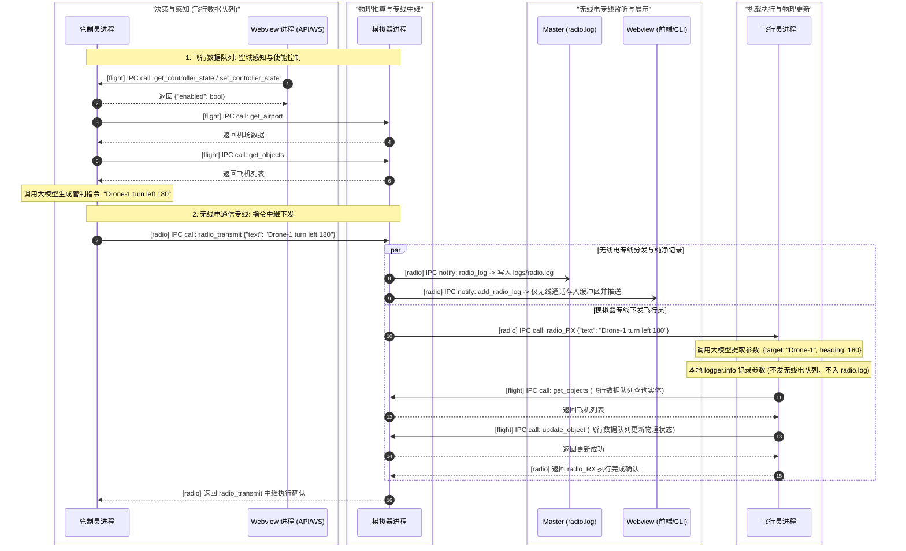
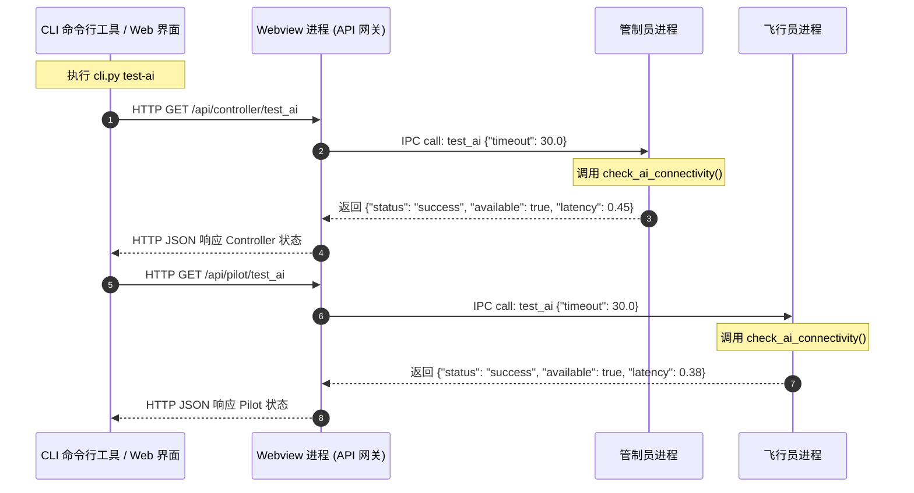
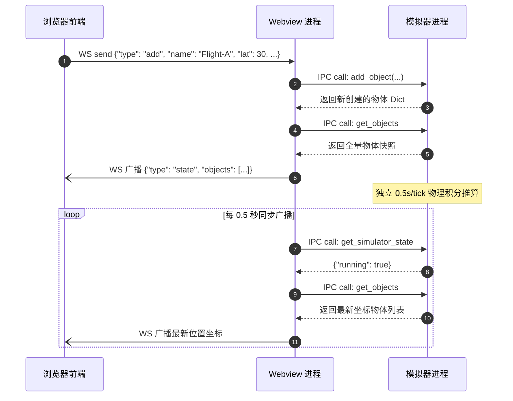

# 实时航空多智能体系统 - 架构与技术文档

本文档全面记录系统重构后的整体架构设计、进程职责、进程生命周期管理、管道进程间通信 (IPC) 协议及各进程开放的通信接口与消息传递流程。

---

## 1. 系统总体架构

本项目是一个基于数字孪生空域的实时航空多智能体协同系统。系统彻底摒弃了外部进程监管工具（如 Supervisord）及原 Platform 单进程内部多线程架构，重构为由 **Master 守护进程** 统一管理、基于 Python 原生 `multiprocessing` 库拉起并守护的 **4 大独立业务进程**，各进程之间全部通过 **双向管道 (`multiprocessing.Pipe`)** 进行高性能、低延迟的进程间通信。

### 1.1 进程拓扑与角色划分

系统由 1 个管理进程与 4 个核心业务进程组成：

### 1.1 进程拓扑与双队列隔离架构

系统由 1 个管理进程与 4 个核心业务进程组成，通信在物理层彻底划分为 **无线电通信专线队列 (Radio IPC Queue)** 与 **飞行数据/系统控制队列 (Flight Data & System IPC Queue)** 两套完全独立的物理管道：

```
+--------------------------------------------------------------------------------------------------------------------+
|                                               Master 进程 (守护进程)                                                |
|   - 进程生命周期管理 (拉起 / 监控 / 重启 / 优雅关机)                                                                 |
|   - 独立集中日志: master.log (全系统常规日志) 与 radio.log (带自动轮转的纯净无线电日志)                              |
+-------------------+----------------------------+-----------------------+-------------------------------------------+
                    |                            |                       |                      |
                    | (master_sim_flight)        | (master_wv_flight)    | (master_ctrl_flight) | (master_pilot_flight)
                    | [radio_log]                |                       |                      |
                    | (master_sim_radio)         |                       |                      |
                    v                            v                       v                      v
         +--------------------+        +--------------------+  +--------------------+  +--------------------+
         |   飞行模拟器进程    |        |    Webview 进程    |  |    管制员智能体    |  |    飞行员智能体    |
         | (airplane_simulator|        |     (webview)      |  | (agent_controller) |  |   (agent_pilot)    |
         +---------+----------+        +----+----------+----+  +---------+----------+  +---------+----------+
                   |                        ^          ^                 |                       ^
                   | (sim_pilot_radio)      |          |                 |                       |
                   |------------------------|----------|-----------------|-----------------------+
                   |                        |          |                 | (ctrl_sim_radio)      |
                   | (sim_wv_radio)         |          |                 +---------------------->+ (中继中枢)
                   +----------------------->+          | (wv_ctrl_flight)                        |
                   |                                   +-----------------+                       |
                   | (pilot_sim_flight: 运动姿态读写)                            |                       |
                   +=============================================================|=======================+
                   | (wv_sim_flight: 物体增删改查/仿真启停)                       | (wv_pilot_flight: 代理测试)
                   +=============================================================+
```

> **双队列物理隔离规范**：
> 1. **无线电通信专线队列 (Radio IPC Queue)**：仅流转真实管制自然语言语音与无线电通话（Controller -> Simulator -> Pilot / Webview / Master），内容纯净写入 `logs/radio.log`，并在 Webview 和 CLI radio 选项中呈现。
> 2. **飞行数据与系统控制队列 (Flight Data & System Queue)**：流转高频运动姿态更新、物体增删改查、仿真启停、心跳与系统日志。飞行员从大模型抽取的机载飞行参数 (`Target: ..., Speed: ...`) 仅在本地通过标准 Logger 记录，经系统队列汇入 `logs/master.log`，**绝不通过无线电管道发送，不污染无线电日志**。

### 1.2 进程功能与职责矩阵

| 进程名称 | 模块文件 | 核心职责 | 双队列通信形式 |
| :--- | :--- | :--- | :--- |
| **Master 进程** | `src/master.py` | 全系统管理核心；负责 IPC 管道拓扑创建、各子进程启动、异常崩溃自愈、信号监听与优雅关机；集中持久化常规日志 (`logs/master.log`)；经由独立的无线电专线收集纯净无线电报文并持久化写入带有自动轮转的 `logs/radio.log`。 | **系统队列**：`master_*_flight`<br>**无线电专线**：`master_sim_radio` |
| **Webview 进程** | `src/platform/webview.py` | 系统的对外唯一接入网关；提供 HTTP REST 接口与 WebSocket 实时推送，接收 CLI 和 Web 前端请求；经由无线电专线接收广播并在内存维护纯净无线电日志缓冲区与分页端点 (`GET /api/radio_log`)；代理 Controller 与 Pilot 的测试请求。 | **系统队列**：`webview_*_flight`<br>**无线电专线**：`sim_webview_radio` |
| **飞行模拟器进程** | `src/platform/airplane_simulator.py` | 独立物理推算引擎兼**无线电通信中继枢纽**；执行飞行器运动学解算；通过专用无线电管道接收管制员报文 (`radio_transmit`)，中继转发至飞行员 (`radio_RX`)，并同步推送至 Master (`radio_log`) 和 Webview (`add_radio_log`)。维持飞行员读写飞机的物理控制接口。 | **飞行数据队列**：`*_sim_flight`<br>**无线电专线**：`*_sim_radio` |
| **管制员智能体** | `src/agent_controller/controller.py` | 进近空管智能体；定时巡检空域态势，调用大模型分析潜在冲突与进近排序；巡航状态仅本地记录日志，需要调配时经由模拟器无线电专线中继下发管制指令。 | **系统队列**：`webview_ctrl_flight`<br>**无线电专线**：`ctrl_sim_radio` |
| **飞行员智能体** | `src/agent_pilot/pilot.py` | 机载飞行员智能体；通过模拟器无线电专线接收管制员无线电指令 (`radio_RX`)；调用大模型解析自然语言语义；抽取控制参数在本地记录标准日志；通过飞行数据专线调用模拟器接口更新飞机状态 (`get_objects`, `update_object`)。 | **飞行数据队列**：`pilot_sim_flight`, `webview_pilot_flight`<br>**无线电专线**：`sim_pilot_radio` |

---

## 2. 进程管理机制 (Process Management)

系统不再依赖 Supervisor，完全使用 Python `multiprocessing` 模块原生实现进程生命周期管理。

### 2.1 启动流程与守护进程化 (Daemonize)

用户通过 `python src/main.py start` 启动系统时，启动过程如下：

1. **初始启动进程** 创建 `MasterProcess` 实例。
2. 调用 `daemonize_master()` 执行经典的 **Unix 双重 Fork (Double-Fork)** 守护进程化流程：
   - 第一次 `os.fork()`：父进程打印启动成功提示与 Master PID，随后立即退出 (`sys.exit(0)`)，终端恢复就绪。
   - 子进程调用 `os.setsid()` 创建新会话，脱离原控制终端与进程组。
   - 第二次 `os.fork()`：防止该进程重新获取终端控制权。
   - 孙进程重定向标准输入至 `/dev/null`，标准输出/错误重定向至 `logs/master.log`。
   - 将 Master PID 写入 `logs/master.pid`。
3. **Master 进程** 初始化管道，依次通过 `multiprocessing.Process` 派生并启动 4 个子业务进程。
4. Master 进程进入健康巡检循环。

> **容器环境支持**：在 Docker 容器或调试环境下，可通过 `python src/main.py --foreground`（或 `-f` / `run`）直接在前台启动 Master 进程（PID 为 1），保持容器常驻运行并正确捕获容器编排信号。

### 2.2 故障检测与自动重启机制 (Auto-Restart)

Master 进程的主循环中以 1.0 秒为周期对所有子进程执行 `proc.is_alive()` 存活检查：
- 若检测到子进程意外终止（非关机状态），Master 记录异常退出码并立即通过保存的双队列管道句柄重新拉起该子进程。
- 保证系统在单个智能体发生未捕获异常时具备自愈能力。

### 2.3 优雅停机流程 (Graceful Shutdown)

当 Master 收到 `SIGTERM` 或 `SIGINT` 信号（或用户执行 `python src/main.py stop`）时：
1. Master 标记 `_shutdown_event`，终止自动重启判定。
2. 通过内部管理管道向各子进程广播 `stop` 指令。
3. 对每个子进程调用 `join(timeout=3.0)` 等待平稳退出。
4. 超时未退出的子进程依次调用 `terminate()` 和 `kill()` 确保资源释放。
5. 关闭所有打开的管道端点并清理 `logs/master.pid`。

---

## 3. 进程间通信机制 (IPC via Pipe)

系统内部进程间彻底废弃 HTTP 协议，改用高效的双向全双工管道 (`multiprocessing.Pipe(duplex=True)`)。

### 3.1 IPCChannel 对象化封装协议

`src/agent_common/ipc.py` 提供了统一的 `IPCChannel` 通信抽象类：

#### 消息帧协议
所有在管道中传输的数据均封装为 Python 字典对象：
- **请求帧 (Request)**:
  ```python
  {
      "type": "req",
      "id": "uuid-字符串",
      "action": "动作名称",
      "params": { ... }
  }
  ```
- **响应帧 (Response)**:
  ```python
  {
      "type": "res",
      "id": "uuid-字符串",
      "status": "success" | "error",
      "data": <返回数据>,
      "error": <错误描述字符串>
  }
  ```
- **单向通知帧 (Notify)**:
  ```python
  {
      "type": "notify",
      "action": "动作名称",
      "params": { ... }
  }
  ```

#### 特性支持
1. **异步非阻塞 (Async RPC)**: `await channel.call(action, params, timeout)`，通过关联 Future 实现跨进程的协程级等待。
2. **同步阻塞 (Sync RPC)**: `channel.call_sync(action, params, timeout)`，通过 `threading.Event` 阻塞等待响应，供非 asyncio 循环（如 Simulator 服务线程）调用。
3. **单向通知 (Notify)**: `channel.notify(action, params)`，无需等待对端确认，用于低延迟无线电日志广播等场景。
4. **异常自动捕获与跨进程传播**: 服务端 handler 抛出的异常会被捕获并打包到响应帧中，客户端收到后自动抛出 `RuntimeError`。
5. **轻量轮询**: 后台接收线程通过 `conn.poll(0.05)` 兼顾低延迟传输与毫秒级优雅退出。

### 3.2 双队列物理隔离与无线电纯净性规范

为解决通信冲突与日志污染，系统在进程间建立了**两套物理隔离的独立队列**：
1. **无线电通信专线队列 (Radio IPC Queue)**：
   - 包含管道对：`ctrl_sim_radio`, `sim_pilot_radio`, `sim_webview_radio`, `master_sim_radio`。
   - **内容纯净性保证**：此队列只流转管制员与飞行员之间的自然语言语音/文字报文。
   - **日志独立性**：只有通过无线电专线队列传输的内容，Master 才会持久化至 `logs/radio.log`，Webview 才会推送至前端无线电面板与 CLI radio 选项。
2. **飞行数据与系统控制队列 (Flight Data & System IPC Queue)**：
   - 包含管道对：`ctrl_sim_flight`, `webview_sim_flight`, `webview_ctrl_flight`, `webview_pilot_flight`, `pilot_sim_flight`, `master_*_flight`。
   - 流转高频运动姿态更新、CRUD、场景重置、健康心跳以及常规系统日志。
3. **飞行参数纯化设计**：
   - 飞行员从大模型抽取飞行参数后（如 `Target: JA-NRT-4000, Speed: 220, Heading: 180, Alt: 2000`），明确属于机载解算数据而非无线电通话。
   - **严禁在无线电专线队列中发送**，且**不需要通过 IPC 发送给其他进程**，直接在飞行员本地通过标准 Logger 记录，经系统常规日志管道汇入 `logs/master.log`。

---

## 4. 进程通信接口开放清单

### 4.1 无线电通信专线队列接口 (Radio IPC Queue)

| 提供进程 | 开放接口 (Action) | 调用方 | 传输队列 | 说明 | 返回值 |
| :--- | :--- | :--- | :--- | :--- | :--- |
| **飞行模拟器** | `radio_transmit` | Controller | `ctrl_sim_radio` | 接收管制员语音指令，中继转发 Pilot，并同步通知 Master 与 Webview。 | `{"status": "success", "relayed": True, "pilot_response": Dict}` |
| **飞行员** | `radio_RX` | Simulator | `sim_pilot_radio` | 接收模拟器中继的无线电指令，调用大模型解算并执行姿态控制。 | `{"status": "success", "resolved_count": int, ...}` |
| **Webview** | `add_radio_log` | Simulator | `sim_webview_radio` | 接收模拟器中继的无线电语音报文，存入历史缓冲区并推送到前端 WebSocket。 | 无 (Notify) |
| **Master** | `radio_log` | Simulator | `master_sim_radio` | 接收模拟器中继的无线电语音报文，统一记录至独立的 `logs/radio.log`（带轮转）。 | 无 (Notify) |

### 4.2 飞行数据与系统控制队列接口 (Flight Data & System IPC Queue)

| 提供进程 | 开放接口 (Action) | 调用方 | 传输队列 | 说明 | 返回值 |
| :--- | :--- | :--- | :--- | :--- | :--- |
| **飞行模拟器** | `get_objects` | Webview, Pilot, Controller | `*_flight` | 获取当前空域所有物体的运动快照。 | `List[Dict]` |
| **飞行模拟器** | `get_object` | Webview | `webview_sim_flight` | 获取单个飞机对象快照。 | `Optional[Dict]` |
| **飞行模拟器** | `add_object` | Webview | `webview_sim_flight` | 添加新飞机实体。 | `Dict` (新创建物体) |
| **飞行模拟器** | `update_object` | Webview, Pilot | `*_flight` | 更新飞机航速、航向、高度或目标姿态。 | `{"found": bool, "object": Dict}` |
| **飞行模拟器** | `remove_object` | Webview | `webview_sim_flight` | 移除指定飞机。 | `bool` |
| **飞行模拟器** | `clear_objects` | Webview | `webview_sim_flight` | 清空所有飞机。 | `bool` |
| **飞行模拟器** | `restore_objects` | Webview | `webview_sim_flight` | 批量恢复飞机快照。 | `List[Dict]` |
| **飞行模拟器** | `start_simulator` | Webview | `webview_sim_flight` | 启动物理仿真积分解算循环。 | `{"status": "success", "running": True}` |
| **飞行模拟器** | `stop_simulator` | Webview | `webview_sim_flight` | 停止物理仿真积分解算循环。 | `{"status": "success", "running": False}` |
| **飞行模拟器** | `get_simulator_state`| Webview | `webview_sim_flight` | 查询物理仿真器当前是否运行。 | `{"running": bool}` |
| **飞行模拟器** | `get_airport` | Webview, Controller | `*_flight` | 获取当前配置的基准机场坐标及跑道方向。 | `{"lat": float, "lon": float, ...}` |
| **飞行模拟器** | `set_airport` | Webview | `webview_sim_flight` | 设置基准机场地理坐标及跑道方向。 | 无 |
| **管制员** | `get_controller_state` | Webview | `webview_ctrl_flight` | 获取 AI 管制员使能开关状态（初始为 disabled）。 | `{"enabled": bool}` |
| **管制员** | `set_controller_state` | Webview | `webview_ctrl_flight` | 设置 AI 管制员使能开关状态。 | `{"status": "success", "enabled": bool}` |
| **管制员** | `test_ai` | Webview | `webview_ctrl_flight` | 测试管制员大模型连通性。 | `{"status": "success", "available": bool, ...}` |
| **飞行员** | `test_ai` | Webview | `webview_pilot_flight` | 测试飞行员大模型连通性。 | `{"status": "success", "available": bool, ...}` |
| **所有子进程** | `ping` / `status` | Master | `master_*_flight` | 进程存活检查与状态汇报。 | `{"status": "ok", "pid": int, ...}` |
| **所有子进程** | `stop` | Master | `master_*_flight` | 平稳停机通知。 | 无 (Notify) |
| **Master 进程**| `log` | 全部子进程 | `master_*_flight` | 统一上报标准日志，由 Master 写入 `logs/master.log`（带轮转）。 | 无 (Notify) |

---

## 5. 消息传递序列图 (Sequence Diagrams)

### 5.1 双队列隔离与无线电指令中继执行流程图



### 5.2 AI 连通性测试流程图 (CLI / Web -> Controller / Pilot)



### 5.3 Web 端操作与物理仿真更新流程图



---

## 6. 集中式日志系统与日志轮转 (Centralized Logging & Rotation)

系统彻底重构了日志采集架构，消除各子进程分散写入独立日志文件所带来的碎片化问题：
1. **进程间通信上报 (`IPCLogHandler`)**：
   - 四大子业务进程初始化时不配置私有 `FileHandler`，而是将标准日志挂载至 `IPCLogHandler`。
   - 日志记录触发时自动由 `record_to_dict` 序列化（携带进程标识 `processName` 与自定义 `extra` 属性），通过 `ch_master.notify("log", data)` 单向通知发往 Master 进程。
   - Webview 服务的 Uvicorn 服务集成 `log_config=None`，将 HTTP 请求访问日志与服务器日志一并无缝汇入集中式管道。
2. **Master 进程集中持久化与轮转**：
   - Master 进程作为唯一日志汇聚管理者，统管所有进程的日志持久化。
   - 日志汇聚至 `logs/master.log`，通过标准库 `logging.handlers.RotatingFileHandler` 支持文件大小限制（默认 10MB）与备份文件保留数量轮转（默认 5 份），支持 `LOG_MAX_BYTES`、`LOG_BACKUP_COUNT`、`LOG_LEVEL` 环境变量。
   - 统一日志输出格式携带清晰的进程标识：`%(asctime)s - [%(processName)s] - %(levelname)s - %(message)s`。
3. **本地容错降级回退 (Fallback)**：
   - 若子进程未连接 Master 管道、管道中断或 IPC 发送出现异常，`IPCLogHandler` 自动安全降级至本地 `StreamHandler`（控制台/标准输出），确保绝不因日志异常导致业务挂起。

### 6.4 独立无线电专用日志与轮转 (`logs/radio.log`)
为支持空管通信审计、无线电指令回放与历史溯源，系统将无线电通讯从系统业务日志中剥离，建立专用的持久化通道：
1. **中继上报**：飞行模拟器在中继转发管制员无线电报文时，同步通过管理管道 `ch_master.notify("radio_log", payload)` 发往 Master。
2. **独立文件与轮转**：Master 进程配置专用的 `self.radio_logger` 与 `RotatingFileHandler`，独立写入 `logs/radio.log`。单文件大小超标后自动滚动生成历史备份（如 `radio.log.1`, `radio.log.2`），避免单文件无限膨胀。
3. **格式化记录**：日志记录格式为 `[%(asctime)s] - [radio] [%(source)s] (%(type)s) %(text)s`，清晰记录通话时间、发送源（管制员/飞行员）及指令全文。

---

## 7. 终端控制台与 CLI 工具 (Platform CLI)

系统在 `cli/cli.py` 提供了统一的终端控制工具，具备交互式控制台菜单与直接命令行子命令双模式：
1. **无线电通信日志查询 (严格经由 Webview HTTP 端点)**：
   - 遵循系统架构解耦原则，CLI **严禁直接通过 IPC 探测模拟器或读取本地 `radio.log` 文件**，严格通过 Webview 提供的开放端点 `GET /api/radio_log` 获取历史数据。
   - 命令用法：
     - `uv run cli/cli.py radio`：查看最近 50 条无线电指令。
     - `uv run cli/cli.py radio --limit 20`：自定义获取条数。
     - `uv run cli/cli.py radio --watch`：实时流式监控（每 2 秒增量拉取新无线电通讯）。
     - `uv run cli/cli.py radio --json`：输出结构化 JSON 数据。
   - 交互模式：运行 `uv run cli/cli.py` 进入主菜单，选择 `[5] Radio` 即可进行可视化交互式查询。
2. **空域飞行状态查看与流式监控 (`state`)**：
   - 专门用于查看当前空域中在飞与在地的全部飞机飞行状态（航速、航向、高度、目标航向/高度等运动学参数）、参考机场坐标及跑道航向、AI 管制员使能状态。
   - 命令用法：
     - `uv run cli/cli.py state`：直接查看当前空域飞行状态快照与飞机参数表格。
     - `uv run cli/cli.py state --watch`（或 `-w`）：开启流式监控模式，默认每 5 秒（可通过 `--interval` 自定义刷新秒数）自动更新并输出最新飞行状态。
     - `uv run cli/cli.py state -w --interval 3.0`：以 3 秒间隔持续监控空域飞行状态。
     - `uv run cli/cli.py state --json`：以 JSON 格式输出当前空域飞行状态数据。
   - 交互模式：运行 `uv run cli/cli.py` 进入主菜单，选择 `[6] State` 即可自动进入流式监控模式，每 5 秒自动更新一次飞行状态（按 `Ctrl+C` 即可优雅停止并返回主菜单）。
3. **场景状态持久化读写 (`save` / `load`)**：
   - 专门用于将当前所有机场坐标、飞机坐标及全部飞行状态保存至 `state.json`，或从 `state.json` 还原场景。
   - 启动行为解耦：服务启动时不再自动读取 `state.json` 覆盖空域，维持干净初始空域；仅在用户显式操作时进行保存与还原。
   - 命令用法：
     - `uv run cli/cli.py save`：保存当前场景状态到 `state.json`。
     - `uv run cli/cli.py load`：从 `state.json` 还原场景状态。
     - `uv run cli/cli.py save --json` / `uv run cli/cli.py load --json`：以 JSON 格式输出保存/还原确认结果。
   - 交互模式：运行 `uv run cli/cli.py` 进入主菜单，选择 `[7] Save / Load` 即可进入专属持久化子菜单。
4. **空域场景彻底重置与停机 (`reset`)**：
   - 支持一键删除模拟器中的全部飞机与机场基准点，并同步停止飞行模拟器推算循环与 AI 管制员调度使能。
   - 命令用法：
     - `uv run cli/cli.py reset`：直接重置空域场景并停止模拟器与管制员。
     - `uv run cli/cli.py reset --json`：输出结构化重置确认 JSON 数据。
   - 交互模式：运行 `uv run cli/cli.py` 进入主菜单，选择 `[8] Reset` 即可交互式确认并执行场景重置。
5. **全指令帮助与用法示例 (`--help` / `help`)**：
   - 具备完整分层级命令帮助系统，详细阐述所有指令用途、参数选项、默认值、互斥规则并附带实用的命令行复制即用示例。
   - 命令用法：
     - `uv run cli/cli.py --help`（或 `uv run cli/cli.py help`）：显示全量 CLI 指令大全与详细使用示例。
     - `uv run cli/cli.py <command> --help`（或 `uv run cli/cli.py help <command>`）：查看具体子指令（如 `state`, `save`, `load`, `airplane`, `airport`, `radio`, `reset`, `on-off` 等）的详细参数与示例。
     - `uv run cli/cli.py airplane add --help`（或 `uv run cli/cli.py help airplane add`）：查看特定二级子指令（如飞机添加、机场配置）的专属选项与坐标设定示例。

---

## 8. 各进程独立设计文档导航

关于各进程的详细内部设计、代码结构、接口定义及算法实现，请参阅各独立文档：
1. **Master 进程文档**: [doc/process_master.md](file:///home/mickey/git/test_of_realtime_AI_agent/doc/process_master.md)
2. **Webview 进程文档**: [doc/process_webview.md](file:///home/mickey/git/test_of_realtime_AI_agent/doc/process_webview.md)
3. **飞行模拟器进程文档**: [doc/process_airplane_simulator.md](file:///home/mickey/git/test_of_realtime_AI_agent/doc/process_airplane_simulator.md)
4. **管制员智能体文档**: [doc/process_agent_controller.md](file:///home/mickey/git/test_of_realtime_AI_agent/doc/process_agent_controller.md)
5. **飞行员智能体文档**: [doc/process_agent_pilot.md](file:///home/mickey/git/test_of_realtime_AI_agent/doc/process_agent_pilot.md)

