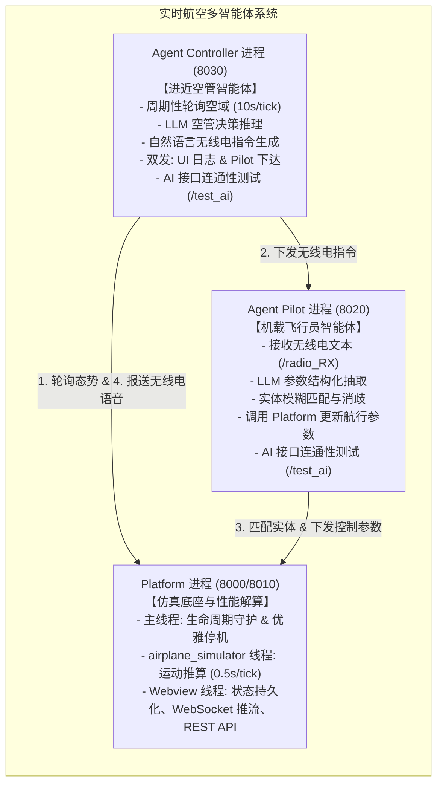

# 实时航空多智能体仿真系统技术文档

本项目是一个结合了实时地理空间物理推算仿真与大语言模型（LLM）多智能体自主协同的航空进近管制与自动驾驶系统。

通过三个独立的微服务进程协同运行，系统模拟了现实航空运行中的**数字孪生与空域仿真（Platform 进程，内置 Webview 线程与 airplane_simulator 线程）**、**进近空中交通管制员（Agent Controller）**以及**机载飞行员 / 自动驾驶计算机（Agent Pilot）**之间的自主交互与动态闭环控制。

---

## 1. 文档导航目录

按照系统设计与进程切分，详细技术分析文档分为以下独立模块：

| 文档名称 | 对应进程 / 主题 | 核心内容概述 |
| :--- | :--- | :--- |
| 📘 [**进程分析：Platform 仿真与性能解算服务**](process_platform.md) | `platform` (`main.py` + `webview.py` + `airplane_simulator.py`) | 进程与双子线程架构（Webview 表现层 + airplane_simulator 运动推算线程）、物理运动学推算算法、大圆航线模型、REST API 清单、WebSocket 全双工协议、状态持久化机制 |
| 📘 [**进程分析：Agent Controller 空管决策智能体**](process_agent_controller.md) | `agent_controller` (`controller.py`) | 进近空管认知模型、10s 周期性轮询感知环路、Prompt 工程设计、指令双发动作与容错机制 |
| 📘 [**进程分析：Agent Pilot 机载指令解析智能体**](process_agent_pilot.md) | `agent_pilot` (`pilot.py`) | 语音指令语义理解、Few-Shot 参数结构化提取、实体名称与 UUID 消歧算法、物理参数下发与遥测 |
| 🌐 [**专项分析：进程间通信机制（IPC）与协作协议**](inter_process_communication.md) | **服务间通信与数据流** | 全景网络拓扑、HTTP REST 接口契约定义、WebSocket 消息结构、11步端到端闭环通信完整时序图 |
| 🧪 [**测试与验证指导**](TEST_README.md) | `test/` | 单元测试规范、Mock 机制、自动化测试套件与执行说明 |

---

## 2. 系统进程总览与职责划分



### 进程参数对照表

| 进程名称 | 入口文件 | 监听端口 | 运行模式 | 关键依赖 / 模型 |
| :--- | :--- | :--- | :--- | :--- |
| **`platform`** | `src/platform/main.py` | `8000` (映射宿主 `8010`) | 主进程 + WebviewThread + airplane_simulator 线程 | Leaflet.js, math, asyncio, websockets, threading |
| **`agent_controller`**| `src/agent_controller/controller.py` | `8030` (容器内部端口，不对外暴露) | FastAPI + Uvicorn 异步服务 + 后台轮询任务 | Gemini 2.5 Flash / OpenAI, httpx, fastapi |
| **`agent_pilot`** | `src/agent_pilot/pilot.py` | `8020` (容器内部端口，不对外暴露) | FastAPI + Uvicorn 异步服务 | Gemini 2.5 Flash / OpenAI, httpx, fastapi |


---

## 3. 核心业务闭环流程

系统的核心业务闭环如下：

1. **空域初始化与仿真启动**：用户在 Platform 地图界面选定机场位置（经纬度及跑道方向），并添加一架或多架飞机（设定初始经纬度、航向、高度、航速）。用户可通过界面上的“飞行模拟器”开关或接口启动后台 `airplane_simulator` 物理推算线程。
2. **空管感知**：`agent_controller` 定期（每 10 秒）通过 `platform` 的 `/api/objects` 接口拉取当前活动的飞机运动状态。
3. **空管决策**：若飞机未处于最佳进近航线，`agent_controller` 利用大模型生成类似现实空管的标准指令（例如：`"Drone-1, turn left heading 040, descend to 1000 feet, cleared for approach"`）。
4. **指令调度**：`agent_controller` 将指令日志发给 `platform` 用于前端回显，同时通过 HTTP 请求发送至 `agent_pilot` 的 `/radio_RX` 接口。
5. **参数提取与执行**：`agent_pilot` 借助大模型从指令文本中抽取出结构化控制参数，并找到目标飞机 UUID，通过 `platform` 的 `/api/update` 接口更新其在 `airplane_simulator` 中的目标航向、高度及航速。
6. **物理平滑过渡与渲染**：`airplane_simulator` 物理推算线程每 0.5 秒计算飞机的大圆航向运动、平滑转向率与爬升率；`Webview` 线程周期性从仿真器读取最新数据，并通过 WebSocket 实时推送到前端地图，直观呈现飞机响应航管指令进行机动的全过程。

---

## 4. 运行与部署架构

### 4.1 容器化运行 (Supervisor 托管)
在 Dockerfile 中，使用 Debian Slim 镜像作为基础运行环境，安装并配置 Supervisor 统一管理三个进程。
Supervisor 配置文件位于 [`docker/supervisord.conf`](../docker/supervisord.conf)，设置了：
- 进程优先级与依赖顺序（`platform` 优先级 10 先起，`agent_pilot` 优先级 20 次之，`agent_controller` 优先级 30 随后启动）。
- 自动拉起与崩溃重启策略（`autorestart=true`）。
- 统一日志输出到标准输出与 `/app/logs/`。

### 4.2 容器编排 (Docker Compose)
通过 [`docker-compose.yml`](../docker-compose.yml) 暴露端口并将本地 `src/` 与 `logs/` 目录挂载到容器中，支持本地代码修改即时生效热重载（Hot Reloading）。

---

## 5. 辅助工具与管理脚本

### 5.1 终端控制台与命令行工具 ([`cli/cli.py`](../cli/cli.py))
在容器外部通过 HTTP 控制 Platform 系统，无需初始化 uv 项目，支持使用 uv 单文件直接执行：
```bash
# 模式 1: 交互式菜单模式 (不带参数直接运行)
uv run cli/cli.py

# 模式 2: 命令行参数模式
# 兼容原 controller_switch 控制 AI 管制员
uv run cli/cli.py status
uv run cli/cli.py on
uv run cli/cli.py off
uv run cli/cli.py toggle

# ON/OFF 开关管理
uv run cli/cli.py on-off simulator on
uv run cli/cli.py on-off simulator status
uv run cli/cli.py on-off controller off

# 飞机管理 (添加、更新目标参数、状态监控)
uv run cli/cli.py airplane add --name Drone-1 --altitude 6000 --heading 180
uv run cli/cli.py airplane update --id <UUID> --heading 090 --altitude 3000
uv run cli/cli.py airplane status
uv run cli/cli.py airplane status --watch

# 机场配置 (手动设置或随机生成)
uv run cli/cli.py airport set --lat 34.817 --lon -85.643 --heading 40
uv run cli/cli.py airport set --random-pos
uv run cli/cli.py airport status
```

### 5.2 飞行模拟器启停控制（UI 开关与 REST API）
- **Webview UI 开关**：前端页面侧边栏提供“飞行模拟器: 运行中 / 已停止”按钮，点击可一键启停 `airplane_simulator` 线程。
- **REST API 端点**：
  ```bash
  # 查询模拟器状态
  curl http://localhost:8010/api/simulator/state
  
  # 启动模拟器
  curl -X POST http://localhost:8010/api/simulator/start
  
  # 停止模拟器
  curl -X POST http://localhost:8010/api/simulator/stop
  ```
