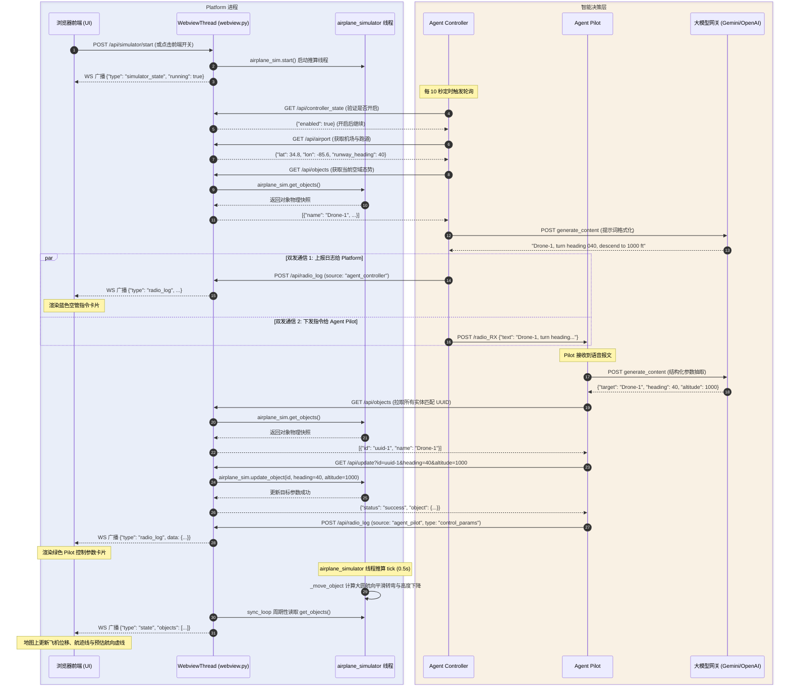

# 进程间通信（IPC）与协作协议专项分析

## 1. 通信架构总览与网络拓扑

本项目采用微服务化、多智能体协同（Multi-Agent System）架构。系统在运行形态上包含 3 个核心后台服务进程（其中 Platform 进程内部包含 Webview 表现层线程与 airplane_simulator 运动推算线程）、1 个前端浏览器客户端以及外部 AI 大模型服务代理。

### 1.1 全景通信拓扑图

```mermaid
flowchart TB
    subgraph Browser["客户端浏览器 (Client)"]
        UI["前端 Leaflet UI / 控制面板 (app.js)"]
    end

    subgraph Container["容器 / 宿主机运行环境 (Docker / Supervisord)"]
        subgraph PlatformProcess["Platform 进程 (main.py, 端口: 8000 / 映射 8010)"]
            MainThr["主线程\n(生命周期与守护)"]
            Webview["Webview 线程 (webview.py)\n[FastAPI, WebSocket, REST API 网关]"]
            Sim["airplane_simulator 线程\n(airplane_simulator.py)\n[物理运动推算 & 实体状态存储]"]
            MainThr -->|管理| Webview
            Webview <-->|跨线程锁保护读取/控制| Sim
        end
        Pilot["Agent Pilot 进程 (pilot.py)\n端口: 8020 (容器内部监听，不对外暴露)"]
        Controller["Agent Controller 进程 (controller.py)\n端口: 8030 (容器内部监听，不对外暴露)"]
    end

    subgraph External["外部服务与代理"]
        LLM["Gemini / OpenAI 代理服务\n(gemini-cli-proxy:8765)"]
    end

    %% 前端与 Webview 线程
    UI <==>|WebSocket: ws://host:port/ws\n(实时状态广播 & 控制下发)| Webview
    UI -->|HTTP POST: /api/airport\n/api/controller_state\n/api/simulator/state| Webview

    %% Controller 通信
    Controller -->|HTTP GET: /api/controller_state\n/api/airport\n/api/objects| Webview
    Controller -->|HTTP POST: /api/radio_log (语音展示)| Webview
    Controller -->|HTTP POST: /radio_RX (下达指令)| Pilot

    %% Pilot 通信
    Pilot -->|HTTP GET: /api/objects\n/api/update\nPOST: /api/radio_log| Webview

    %% AI 调用
    Controller -.->|HTTP POST: 大模型推理 (进近空管决策)| LLM
    Pilot -.->|HTTP POST: 大模型推理 (参数提取与JSON规整)| LLM
```

### 1.2 部署模式下的网络寻址

| 部署形态 | Platform 服务地址 (`PLATFORM_URL`) | Pilot 进程通信地址 (`PILOT_URL`) | Controller 进程通信地址 (`CONTROLLER_URL`) | 外部浏览器访问地址 |
| :--- | :--- | :--- | :--- | :--- |
| **容器模式 (Docker Compose)** | `http://127.0.0.1:8000` | `http://127.0.0.1:8020` | `http://127.0.0.1:8030` | `http://<宿主机IP>:8010` |
| **本地多终端开发模式** | `http://localhost:8010` 或 `8000` | `http://localhost:8020` | `http://localhost:8030` | `http://localhost:8000` |


> [!NOTE]
> 在同一 Docker 容器中运行时，所有进程共享同一个网络命名空间（Network Namespace / Loopback），因此进程间可通过 `127.0.0.1` 实现低延迟回环通信。

---

## 2. 通信协议与通道分类

系统综合应用了 3 类主要通信协议：
1. **HTTP/1.1 RESTful API**：用于进程间点对点的同步命令下发、状态拉取与事件报送（使用 `httpx.AsyncClient` 异步非阻塞调用）。
2. **WebSocket (RFC 6455)**：用于 Webview 与前端浏览器间的全双工持久连接，承载高频物理帧推送（2 Hz）和毫秒级 UI 交互。
3. **HTTP 代理长连接 (AI API)**：Controller 与 Pilot 分别通过公共客户端 [`agent_common/ai_client.py`](file:///home/mickey/git/test_of_realtime_AI_agent/src/agent_common/ai_client.py) 与外部 Gemini/OpenAI 网关交互。

---

## 3. 点对点通信接口与契约规范

### 3.1 通道一：Agent Controller $\to$ Platform (Webview 线程)

Controller 作为空域观测者，以 10 秒为周期主动轮询 Platform 进程中 Webview 线程提供的状态接口，并在决策后上报日志。

#### 1) 获取空管总开关状态
- **方法与路径**：`GET /api/controller_state`
- **请求参数**：无
- **响应报文**：
  ```json
  { "enabled": true }
  ```

#### 2) 获取机场位置与跑道方位
- **方法与路径**：`GET /api/airport`
- **请求参数**：无
- **响应报文**：
  ```json
  {
    "lat": 34.817186,
    "lon": -85.643921,
    "runway_heading": 40.0
  }
  ```

#### 3) 获取空域所有飞行器态势
- **方法与路径**：`GET /api/objects`
- **实现原理**：Webview 线程直接从 `airplane_simulator` 线程读取最新运动学快照并返回。
- **请求参数**：无
- **响应报文**：
  ```json
  [
    {
      "id": "76ec27df-2f3b-4ce1-8079-0524cb51b4ca",
      "name": "Drone-1",
      "lat": 34.901234,
      "lon": -85.712345,
      "heading": 360.0,
      "speed_knots": 120.0,
      "altitude_ft": 4500.0,
      "vertical_speed_ft_min": 0.0,
      "turn_rate_deg_sec": 3.0,
      "target_heading": 360.0,
      "target_altitude_ft": 4500.0
    }
  ]
  ```

#### 4) 上报空管无线电指令与监控信息
- **方法与路径**：`POST /api/radio_log`
- **请求载荷**：
  ```json
  {
    "source": "agent_controller",
    "type": "voice",
    "text": "Drone-1, turn left heading 040, descend to 1000 feet, cleared for approach"
  }
  ```
- **成功响应**：
  ```json
  { "status": "success" }
  ```

---

### 3.2 通道二：Agent Controller $\to$ Agent Pilot

当 Controller 判定需引导飞机航迹时，将自然语言无线电语音直接发送给 Pilot 进程。

- **目标端点**：`http://${PILOT_URL}/radio_RX`
- **请求格式**：`application/json`
- **请求载荷**：
  ```json
  {
    "text": "Drone-1, turn left heading 040, descend to 1000 feet, cleared for approach runway 04"
  }
  ```
- **成功响应**：
  ```json
  {
    "status": "success",
    "resolved_count": 1,
    "resolved_ids": ["76ec27df-2f3b-4ce1-8079-0524cb51b4ca"],
    "extracted": {
      "target": "Drone-1",
      "speed": null,
      "heading": 40.0,
      "altitude": 1000.0
    },
    "platform_responses": [
      {
        "id": "76ec27df-2f3b-4ce1-8079-0524cb51b4ca",
        "response": { "status": "success", "object": { ... } }
      }
    ]
  }
  ```

---

### 3.3 通道三：Agent Pilot $\to$ Platform (Webview 线程 $\to$ airplane_simulator)

Pilot 解析出结构化控制量后，访问 Platform 进程查找实体、更新仿真状态并回传执行日志。

#### 1) 查询匹配对象列表
- **方法与路径**：`GET /api/objects`（委托 `airplane_simulator.get_objects()` 返回，用于名称与呼号模糊匹配消歧）。

#### 2) 修改飞行器物理控制目标
- **方法与路径**：`GET /api/update`
- **处理流程**：Webview 线程将参数转发至 `airplane_simulator.update_object()`，更新其内部目标航向、高度或航速。
- **Query 参数**：
  - `id`: 实体 UUID
  - `heading`: 目标航向角（度）
  - `altitude`: 目标高度（英尺）
  - `speed`: 目标航速（节）
- **响应报文**：
  ```json
  {
    "status": "success",
    "object": {
      "id": "76ec27df-2f3b-4ce1-8079-0524cb51b4ca",
      "name": "Drone-1",
      "target_heading": 40.0,
      "target_altitude_ft": 1000.0,
      ...
    }
  }
  ```

#### 3) 回传执行控制参数（遥测审计）
- **方法与路径**：`POST /api/radio_log`
- **请求载荷**：
  ```json
  {
    "source": "agent_pilot",
    "type": "control_params",
    "data": {
      "target": "Drone-1",
      "speed": null,
      "heading": 40.0,
      "altitude": 1000.0
    }
  }
  ```

---

### 3.4 通道四：Platform (Webview 线程) $\leftrightarrow$ 前端客户端 / 外部控制端

#### 1) 飞行模拟器线程控制 REST API

| 路径 | 方法 | 请求体 | 响应报文 | 说明 |
| :--- | :--- | :--- | :--- | :--- |
| `/api/simulator/state` | `GET` | 无 | `{"running": bool}` | 查询 airplane_simulator 线程当前是否在运行 |
| `/api/simulator/state` | `POST` | `{"running": bool}` | `{"status": "success", "running": bool}` | 启停 airplane_simulator 线程并广播给 WS |
| `/api/simulator/start` | `POST` | 无 | `{"status": "success", "running": true}` | 启动 airplane_simulator 线程 |
| `/api/simulator/stop` | `POST` | 无 | `{"status": "success", "running": false}` | 停止 airplane_simulator 线程 |

#### 2) WebSocket 全双工长连接 (`/ws`)

- **连接端点**：`ws://<host>:<port>/ws`
- **通信格式**：JSON 文本帧

##### 服务端向客户端的下行消息 (Downlink)

| 消息 `type` | 触发时机 | 典型载荷结构 | 说明 |
| :--- | :--- | :--- | :--- |
| `state` | airplane_simulator 运行时 (0.5s) 或对象增删改时 | `{"type": "state", "objects": [...]}` | 全量飞机航迹数据（含经纬度、当前高度、目标航向等） |
| `airport` | 连接初始握手、或机场参数保存时 | `{"type": "airport", "lat": 34.8, "lon": -85.6, "runway_heading": 40}` | 机场坐标与跑道朝向 |
| `controller_state` | 连接初始握手、或空管开关切换时 | `{"type": "controller_state", "enabled": true}` | 同步控制台开关状态 |
| `simulator_state` | 连接初始握手、或模拟器开关切换时 | `{"type": "simulator_state", "running": false}` | 同步飞行模拟器线程运行状态 |
| `radio_log` | 收到 Controller 或 Pilot 的上报时 | `{"type": "radio_log", "source": "agent_controller", "msg_type": "voice", "text": "...", "timestamp": 1775...}` | 前端无线电日志卡片渲染 |

##### 客户端向服务端的上行消息 (Uplink)

- **创建新飞行器**：
  ```json
  {
    "type": "add",
    "name": "Alpha-1",
    "lat": 34.90,
    "lon": -85.70,
    "speed_knots": 100,
    "heading": 360,
    "altitude_ft": 5000,
    "target_heading": 360,
    "target_altitude_ft": 5000,
    "turn_rate_deg_sec": 3.0,
    "vertical_speed_ft_min": 400
  }
  ```
- **手动调节参数**：
  ```json
  {
    "type": "update",
    "id": "76ec27df-2f3b-4ce1-8079-0524cb51b4ca",
    "speed_knots": 150,
    "heading": 90,
    "target_heading": 180,
    "altitude_ft": 4000,
    "target_altitude_ft": 2000,
    "turn_rate_deg_sec": 3.0,
    "vertical_speed_ft_min": 500
  }
  ```
- **删除实体**：
  ```json
  {
    "type": "remove",
    "id": "76ec27df-2f3b-4ce1-8079-0524cb51b4ca"
  }
  ```

---

### 3.5 通道五：Platform CLI $\leftrightarrow$ Agent Controller / Agent Pilot (AI 接口联通性测试)

CLI 工具（`cli/cli.py`）可通过一级菜单 `Test AI Endian` 或命令行参数 `test-ai` / `test-ai-endian` 发起针对智能体进程大模型连通性的测试请求。

#### 1) 通信机制 (全量经由 Webview 代理)
CLI 与管制员及飞行员的通信完全通过 Webview (Platform 网关) 的 API 代理端点完成，不对外暴露亦不直接连接管制员/飞行员端口：
- **管制员代理**：`GET ${PLATFORM_URL}/api/controller/test_ai`
- **飞行员代理**：`GET ${PLATFORM_URL}/api/pilot/test_ai`

#### 2) 测试结果报文规范
```json
{
  "status": "success",
  "source": "agent_controller",
  "available": true,
  "client_type": "openai",
  "latency": 5.23,
  "response": "OK",
  "timestamp": 1791440213.33
}
```

---

## 4. 端到端闭环通信完整时序图


以下时序展示了一个完整的自动化空管调配与执行周期：



---

## 5. 通信并发、一致性与容错机制

### 5.1 异步并发与非阻塞 I/O
- 所有跨进程 HTTP 通信均采用基于 `asyncio` 和 `httpx.AsyncClient` 的非阻塞网络 I/O，保证在大模型推理网络延迟（数秒）期间，各微服务仍然能处理其他接口请求。

### 5.2 跨线程状态一致性与互斥锁保护
- 实体数据字典 `_objects` 完全移交至 `AirplaneSimulator` 集中维护。
- `AirplaneSimulator` 内部所有增删改查动作均由底层的 `threading.Lock()` 严格互斥保护，杜绝了“Webview 线程处理 HTTP/WS 请求”、“airplane_simulator 线程推算运动位移”、“外部智能体拉取快照”并发交错引发的数据竞争。

### 5.3 异常隔离与自动恢复
1. **降级与容错重试**：
   - Controller 在任意一次 GET / POST 失败时，会截获异常、输出日志并休眠 10 秒，在下一个周期重新感知，避免雪崩。
   - Pilot 识别目标失败时，返回带有详细 `extracted` 的错误报文，不影响仿真引擎正常运行。
2. **WebSocket 断线重连机制**：
   - 前端 JavaScript（[`app.js`](file:///home/mickey/git/test_of_realtime_AI_agent/src/platform/static/app.js#L202)）在监听到连接关闭事件后，以 1.5 秒为间隔自动发起重新连接，并在重新连上后拉取初始状态。
3. **Supervisor 进程级防护**：
   - 若任意微服务进程因未捕获异常退出，Supervisor 会根据 `autorestart=true` 策略在毫秒级内重启失败进程。
