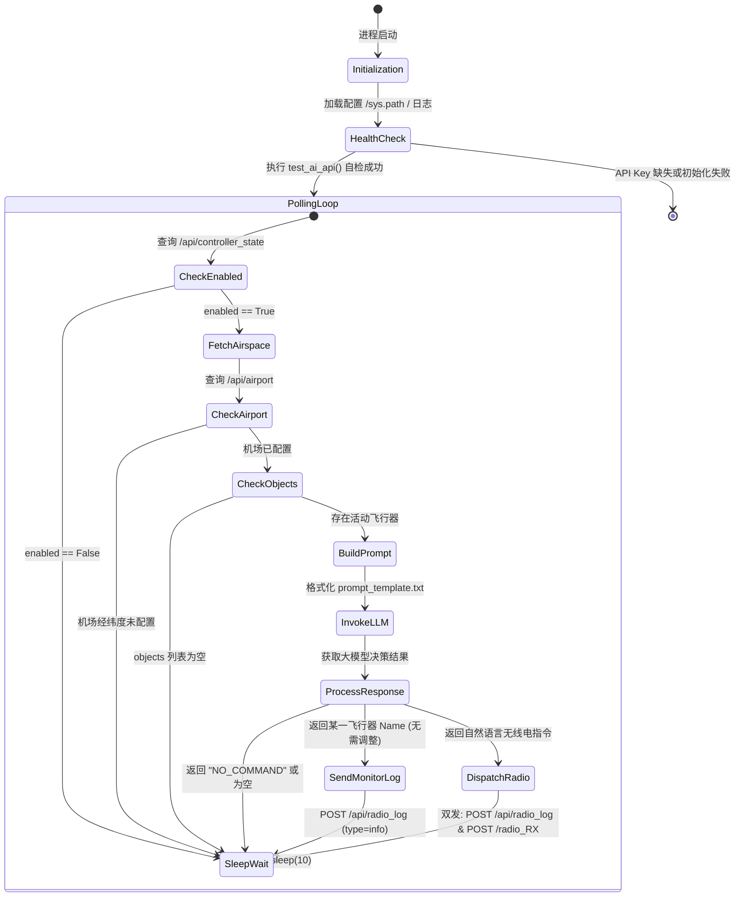
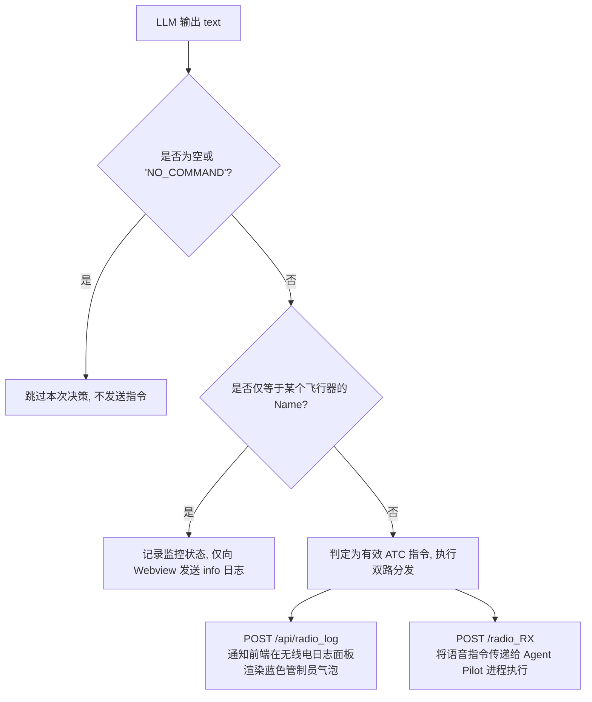

# 进程分析：Agent Controller 空管决策智能体进程

## 1. 进程概览

- **进程名称**：`agent_controller`
- **入口文件**：[`src/agent_controller/controller.py`](file:///home/mickey/git/test_of_realtime_AI_agent/src/agent_controller/controller.py)
- **提示词模板**：[`src/agent_controller/prompt_template.txt`](file:///home/mickey/git/test_of_realtime_AI_agent/src/agent_controller/prompt_template.txt)
- **服务类型**：基于 FastAPI 的微服务 + 常驻异步后台轮询任务
- **默认监听端口**：`8030`
- **启动命令**（见 [`docker/supervisord.conf`](file:///home/mickey/git/test_of_realtime_AI_agent/docker/supervisord.conf)）：
  ```bash
  /app/.venv/bin/python controller.py
  ```
- **核心定位**：扮演空域中的**进近管制员 (Approach Controller)**。以固定频率主动感知空域态势（机场、跑道、全部飞行器的实时坐标、航向、高度和航速），利用大语言模型（LLM）进行智能空管决策，生成规范的航空管制自然语言无线电指令；同时对外提供 `/test_ai` 接口供 CLI 或运维平台测试大模型接口连通性。


---

## 2. 进程控制循环与状态转移机

`agent_controller` 采用基于协程的无限循环轮询机制，其状态机转移逻辑如下：



---

## 3. 详细执行动作分解

### 3.1 启动与环境自检动作
1. **依赖注入与日志初始化**：
   - 动态将 `src/` 目录加入 `sys.path`，以便引入公共依赖模块 [`agent_common.ai_client`](file:///home/mickey/git/test_of_realtime_AI_agent/src/agent_common/ai_client.py)。
   - 配置双写日志记录器（写入 `logs/controller.log` 及标准输出终端）。
2. **LLM 模型可用性验证**：
   - 调用 [`get_ai_model()`](file:///home/mickey/git/test_of_realtime_AI_agent/src/agent_common/ai_client.py#L61) 验证 API Key 是否配置。
   - 调用 [`test_ai_api()`](file:///home/mickey/git/test_of_realtime_AI_agent/src/agent_common/ai_client.py#L88) 发送一次握手问询（`"Hello, this is a test. Reply with 'OK'."`），确认网络与代理通道可用并度量往返耗时。

### 3.2 空域感知与门禁检查 (`run_loop`)
在主循环中，进程每 10 秒（`await asyncio.sleep(10)`）执行一次环境采样：

#### 1) 软件开关检查 (`get_controller_state`)
- 发起异步 HTTP GET 请求：`http://${PLATFORM_URL}/api/controller_state`。
- 如果返回的 `enabled` 字段为 `False`（前端 UI 关闭了 AI 管制员开关），控制器记录当前状态并跳过后续决策，休眠 10 秒后重新轮询。

#### 2) 机场态势读取 (`get_airport`)
- 发起异步 HTTP GET 请求：`http://${PLATFORM_URL}/api/airport`。
- 提取 `lat`、`lon` 和 `runway_heading`。如果 `lat` 或 `lon` 为 `None`，说明用户尚未在地图上选定机场位置，管制员输出警告日志并挂起等待。

#### 3) 飞行器全量数据拉取 (`get_objects`)
- 发起异步 HTTP GET 请求：`http://${PLATFORM_URL}/api/objects`。
- 获取当前在空域中活动的所有飞行器列表（该数据由 Platform 内部的 `airplane_simulator` 物理推算线程实时维护）。如果列表为空（无飞机在空中飞行），则无需消耗 Token 进行推理，直接休眠等待。

### 3.3 提示词组装与 LLM 决策
控制器读取同级目录下的 [`prompt_template.txt`](file:///home/mickey/git/test_of_realtime_AI_agent/src/agent_controller/prompt_template.txt)，将当前的动态数据注入变量占位符：
```python
prompt = template.format(
    airport_lat=airport_lat,
    airport_lon=airport_lon,
    runway_heading=runway_heading if runway_heading is not None else "Not set",
    objects=objects
)
text = generate_ai_response(prompt)
```

**提示词工程设计剖析**：
- **角色定位**：明确为进近管制员（Approach Controller），核心任务是引导空域内的航空器加入五边进近航线（Traffic Pattern）并在指定机场降落。
- **上下文注入**：输入跑道方位角与全部飞机的三维坐标、航向、高度和航速。
- **输出格式约束**：
  1. 自然语言管制指令（必须明确提及目标机名/呼号，例如 `"Drone-1, turn left heading 180, descend to 2000 feet, cleared for approach"`）。
  2. 若某架飞机当前航迹姿态理想无需调整，只回复该飞机的名称（如 `"Drone-1"`）。
  3. 若所有飞机航行良好无需新指令，回复 `"NO_COMMAND"`。
  4. 严禁输出任何多余问候或解释说明。

### 3.4 决策结果解析与多路分发动作

控制器对 LLM 返回的文本 `text` 进行分支路由判断：



#### 动作 A：无需调配处理（同名回复）
如果模型认为目标飞机姿态已经对准跑道或符合航线，仅输出了飞机名（`text in object_names`）：
- 控制器构建 `{"source": "agent_controller", "type": "info", "text": "Monitoring {text}, no instruction needed."}`。
- 仅向 Platform 进程（Webview 线程）的 `/api/radio_log` 发送通知，**不向 Pilot 发送指令**，避免引发不必要的机载自动驾驶动作。

#### 动作 B：有效 ATC 指令双发（`send_radio_message`）
当生成了具体的管制自然语言指令时，控制器通过异步客户端 `httpx.AsyncClient` **并发调用两个下游目标**：
1. **向 Platform 报送**：
   - 目标接口：`POST http://${PLATFORM_URL}/api/radio_log`
   - 请求载荷：
     ```json
     {
       "source": "agent_controller",
       "type": "voice",
       "text": "Drone-1, turn left heading 180, descend to 2000 feet, cleared for approach"
     }
     ```
   - 目的：让前端操作界面与控制台能实时回显空管的语音播报内容。
2. **向 Agent Pilot 下发**：
   - 目标接口：`POST http://${PILOT_URL}/radio_RX`
   - 请求载荷：
     ```json
     {
       "text": "Drone-1, turn left heading 180, descend to 2000 feet, cleared for approach"
     }
     ```
   - 目的：将控制指令交由飞行员智能体解析并落实到具体的飞行控制参数上。

### 3.5 AI 连通性测试接口 (`/test_ai`)

- **方法与路径**：`GET /test_ai` 或 `POST /test_ai`
- **功能描述**：供 Platform CLI、Webview 代理或外部自动化测试脚本请求管制员进程测试底层大模型接口的联通性与响应延时。
- **响应载荷示例**：
  ```json
  {
    "status": "success",
    "available": true,
    "client_type": "openai",
    "latency": 5.23,
    "response": "OK",
    "source": "agent_controller",
    "timestamp": 1791440213.33
  }
  ```

---

## 4. 网络与环境依赖配置

进程通过读取环境变量确定通信终结点：
- `PLATFORM_URL`：默认 `http://localhost:8010`（在 Docker Compose 中配置为容器内部地址 `http://127.0.0.1:8000`）。
- `PILOT_URL`：默认 `http://localhost:8020`（在 Docker Compose 中配置为容器内部地址 `http://127.0.0.1:8020`）。
- `AI_CLIENT_TYPE` / `OPENAI_API_BASE` / `OPENAI_API_KEY` / `GEMINI_API_KEY`：驱动公共 AI 客户端的调用参数。

---

## 5. 健壮性与故障容忍

1. **HTTP 网络异常容忍**：
   所有调用 `get_airport`、`get_objects`、`get_controller_state` 及 `send_radio_message` 均包含独立的 `try...except Exception as e` 异常捕获块，网络瞬断或下游服务重启仅会打印 `logger.error`，不会造成主事件循环崩溃退出。
2. **大模型调用容错**：
   若 LLM 接口出现超时、限流（429）或代理断开，外层主循环捕获异常并暂停 10 秒后自动重试下一轮空域扫描。
3. **Supervisor 自动守护**：
   在容器内由 Supervisor 统一托管（`autorestart=true`），即使发生不可逆致命错误亦会被宿主级守护进程自动拉起。
