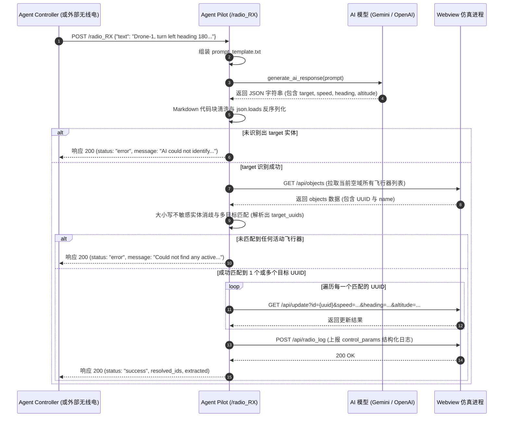

# 进程分析：Agent Pilot 机载指令解析智能体进程

## 1. 进程概览

- **进程名称**：`agent_pilot`
- **入口文件**：[`src/agent_pilot/pilot.py`](file:///home/mickey/git/test_of_realtime_AI_agent/src/agent_pilot/pilot.py)
- **提示词模板**：[`src/agent_pilot/prompt_template.txt`](file:///home/mickey/git/test_of_realtime_AI_agent/src/agent_pilot/prompt_template.txt)
- **服务类型**：基于 FastAPI 的微服务
- **默认监听端口**：`8020`
- **启动命令**（见 [`docker/supervisord.conf`](file:///home/mickey/git/test_of_realtime_AI_agent/docker/supervisord.conf)）：
  ```bash
  /app/.venv/bin/uvicorn pilot:app --host 0.0.0.0 --port 8020 --reload
  ```
- **核心定位**：扮演机载飞行员 / 飞控计算机（Flight Management System, FMS）。负责接收空管发送的自然语言无线电指令，利用大语言模型（LLM）精准抽取出目标飞行器标识及结构化操纵参数（目标航速、目标航向、目标高度），并完成与底层空域实体的实体对齐与控制量下发。

---

## 2. 内部架构与指令处理流水线

Agent Pilot 进程围绕 `/radio_RX` 接口构建了一个端到端的意图理解与飞控参数转换管道：



---

## 3. 详细执行动作与实现机制

### 3.1 生命周期与健康检查 (`lifespan`)
使用 FastAPI 的 `@asynccontextmanager` 生命周期上下文，在服务启动时主动调用 [`test_ai_api()`](file:///home/mickey/git/test_of_realtime_AI_agent/src/agent_common/ai_client.py#L88)，提前验证 AI API 连通性，防止首次请求因认证失败或网络超时而阻塞。

### 3.2 接口规范与参数解析 (`/radio_RX`)

#### 1) 接口签名
- **URL**：`/radio_RX`
- **Method**：`POST`
- **请求体（Pydantic 模型）**：
  ```python
  class RadioCommand(BaseModel):
      text: str  # 自然语言无线电指令，包含呼号与飞控动作
  ```

#### 2) Prompt 工程与 Few-Shot 约束
进程从 [`prompt_template.txt`](file:///home/mickey/git/test_of_realtime_AI_agent/src/agent_pilot/prompt_template.txt) 加载提示词模板，并注入原始无线电文本 `{input_text}`。
- **抽取规范**：
  - `target`：目标飞行器核心标识（强制清洗并剔除 `"object"`, `"ID"`, `"aircraft"`, `"callsign"`, `"物体"`, `"编号"` 等前缀修饰词，保留纯净标识如 `"Drone-Alpha"` 或 `"7a2b"`）。
  - `speed`：目标空速（节 Knots），未提及则返回 `null`。
  - `heading`：目标航向角（$0^\circ \sim 360^\circ$），未提及则返回 `null`。
  - `altitude`：目标飞行高度（英尺 Feet），未提及则返回 `null`。
- **Few-Shot 范例引导**：内置转弯爬升与变速两个标准示例，强制大模型以纯 JSON 输出，杜绝发散。

#### 3) 响应文本清洗与容错
大语言模型有时会在响应中附带 Markdown 标记（例如 ````json ... ````），Pilot 实现了鲁棒的字符串切片与解析保护：
```python
if content.startswith("```json"):
    content = content[7:-3].strip()
elif content.startswith("```"):
    content = content[3:-3].strip()

params = json.loads(content)
extracted_target = params.get("target")
```

### 3.3 实体匹配与消歧算法 (Entity Disambiguation)
自然语言中的飞机呼号可能与仿真引擎中的底层唯一 ID 存在映射差异。Pilot 实现了名称与 UUID 双重回溯机制：
1. 发起 HTTP GET 请求拉取 Platform 进程的全量对象列表：`GET ${PLATFORM_URL}/api/objects`（底层由 Platform 的 `airplane_simulator` 仿真线程提供数据）。
2. 采用**大小写不敏感**比对（Case-insensitive match）：
   ```python
   for obj in all_objects:
       if (extracted_target.lower() == obj["id"].lower() or 
           extracted_target.lower() == obj["name"].lower()):
           target_uuids.append(obj["id"])
   ```
3. **支持一对多集群广播控制**：如果空域中存在多个同名编队飞机（例如通过测试脚本创建的名为 `MultiTest` 的多个无人机），算法能够一次性收集全部匹配实体的 UUID，实现“一条语音指令，编队同步响应”的能力。

### 3.4 物理仿真参数变更下发
对于匹配成功的每个 `uuid`，Pilot 组装 Query 参数并向 Platform 进程发送更新请求：
- **请求地址**：`GET ${PLATFORM_URL}/api/update`
- **动态 Query 参数注入**：
  - `id`: `uuid`（必填）
  - 若 `params.get("speed") is not None`：注入 `speed={value}`
  - 若 `params.get("heading") is not None`：注入 `heading={value}`（在仿真推算中作为 `target_heading` 执行平滑转向）
  - 若 `params.get("altitude") is not None`：注入 `altitude={value}`（在仿真推算中作为 `target_altitude_ft` 执行平滑爬升/下降）
- Platform 收到更新后，直接委托给内部的 `airplane_simulator` 线程更新目标物理参数；在模拟器运行期间，每次 0.5s 的积分 tick 驱动飞机向目标航向和高度平滑过渡。

### 3.5 遥测审计日志回传
参数下发完成后，Pilot 进程主动向 Platform 报送结构化执行日志：
- **目标接口**：`POST ${PLATFORM_URL}/api/radio_log`
- **报文格式**：
  ```json
  {
    "source": "agent_pilot",
    "type": "control_params",
    "data": {
      "target": "Drone-1",
      "speed": 150,
      "heading": 180,
      "altitude": 2000
    }
  }
  ```
- **UI 联动效果**：Platform Webview 线程通过 WebSocket 广播该事件，前端左侧栏随即展示出浅绿色的 Pilot 参数卡片，呈现真实的空管发令与飞控执行闭环回显。

---

## 4. 接口返回值定义

`/radio_RX` 返回给调用方的 JSON 数据规范：

### 成功响应示例 (HTTP 200)
```json
{
  "status": "success",
  "resolved_count": 1,
  "resolved_ids": ["f82d1c44-b045-4228-877e-97cfa906e5da"],
  "extracted": {
    "target": "Drone-1",
    "speed": 150,
    "heading": 180,
    "altitude": 2000
  },
  "platform_responses": [
    {
      "id": "f82d1c44-b045-4228-877e-97cfa906e5da",
      "response": {
        "status": "success",
        "object": { ... }
      }
    }
  ]
}
```

### 异常响应示例 (HTTP 200 业务错误 / HTTP 500 系统异常)
1. **无法识别目标**：
   ```json
   {
     "status": "error",
     "message": "AI could not identify which object you are talking to.",
     "extracted": { "target": null, "speed": 150, "heading": null, "altitude": null }
   }
   ```
2. **目标未找到**：
   ```json
   {
     "status": "error",
     "message": "Could not find any active objects matching 'Drone-999'",
     "extracted": { "target": "Drone-999", ... }
   }
   ```
3. **API Key 缺失或网络异常**：返回 HTTP 500 与详细错误信息。

### 4.2 AI 连通性测试接口 (`/test_ai`)

- **方法与路径**：`GET /test_ai` 或 `POST /test_ai`
- **功能描述**：供 Platform CLI、Webview 代理或外部自动化测试脚本请求飞行员进程测试底层大模型接口的联通性与响应延时。
- **响应载荷示例**：
  ```json
  {
    "status": "success",
    "available": true,
    "client_type": "openai",
    "latency": 5.38,
    "response": "OK",
    "source": "agent_pilot",
    "timestamp": 1791440213.33
  }
  ```

---


## 5. 测试与验证支持

在项目 [`test/test_pilot_ai.py`](file:///home/mickey/git/test_of_realtime_AI_agent/test/test_pilot_ai.py) 和 [`test/test_pilot.sh`](file:///home/mickey/git/test_of_realtime_AI_agent/test/test_pilot.sh) 中均针对 Pilot 进程进行了完备测试：
- 通过 `unittest.mock` 模拟 `google.generativeai.GenerativeModel.generate_content` 和 `httpx.AsyncClient`，验证提取逻辑与接口调用链。
- 通过 shell 脚本发起包含编队同名飞机的端到端真实测试，验证批量更新与数据回写能力。
